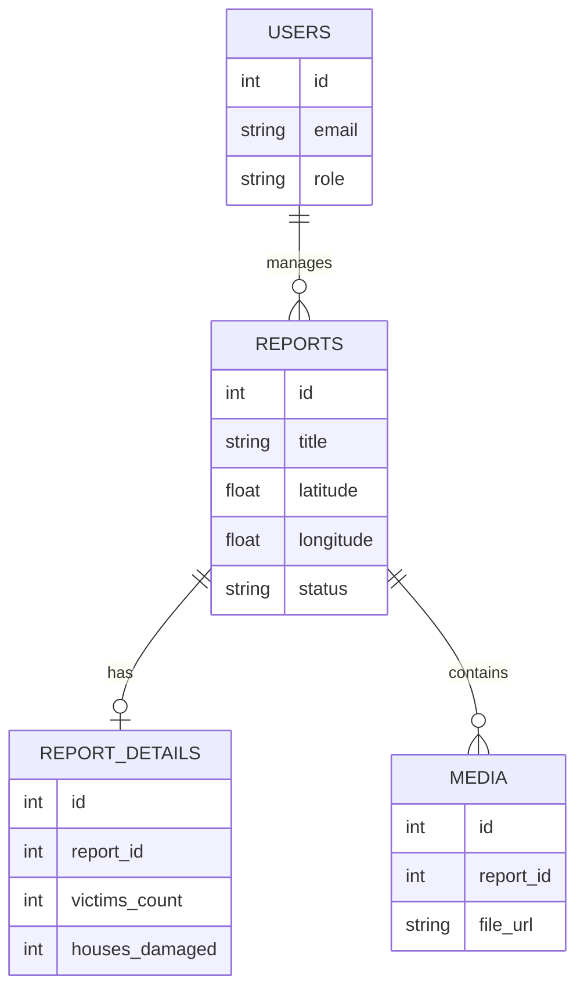

# Entity Relationship Diagram (ERD) - TDMRC

## `users` (System Administrators / Staff)
| Column | Type | Constraints | Description |
|---|---|---|---|
| id | SERIAL | PK | Unique ID |
| email | VARCHAR(255) | UNIQUE, NOT NULL | Staff email |
| password_hash | VARCHAR(255) | NOT NULL | Hashed password (Bcrypt) |
| role | VARCHAR(50) | DEFAULT 'staff' | 'admin', 'staff', 'volunteer' |
| created_at | TIMESTAMP | DEFAULT NOW() | |

## `reports` (Disaster Reports)
| Column | Type | Constraints | Description |
|---|---|---|---|
| id | SERIAL | PK | Unique Report ID |
| title | VARCHAR(255) | NOT NULL | Short title of the event |
| description | TEXT | | Detailed description (losses, status) |
| catastrophe_type | VARCHAR(100) | | Flood, Earthquake, Landslide, etc. |
| latitude | DECIMAL(10, 8) | NOT NULL | Geo location |
| longitude | DECIMAL(11, 8) | NOT NULL | Geo location |
| location_name | VARCHAR(255) | | Village/District name |
| status | VARCHAR(50) | DEFAULT 'pending'| 'pending', 'verified', 'resolved' |
| reporter_name | VARCHAR(100) | | Name of person reporting (if public) |
| contact_info | VARCHAR(100) | | Phone/Email of reporter |
| reported_at | TIMESTAMP | DEFAULT NOW() | Time of occurrence |

## `report_details` (granular stats)
| Column | Type | Constraints | Description |
|---|---|---|---|
| id | SERIAL | PK | |
| report_id | INT | FK -> reports.id | |
| victims_count | INT | DEFAULT 0 | Fatalities |
| injured_count | INT | DEFAULT 0 | |
| displaced_count | INT | DEFAULT 0 | |
| houses_damaged | INT | DEFAULT 0 | |
| houses_destroyed | INT | DEFAULT 0 | |

## `media` (Photos/Videos)
| Column | Type | Constraints | Description |
|---|---|---|---|
| id | SERIAL | PK | |
| report_id | INT | FK -> reports.id | |
| file_url | VARCHAR(500) | NOT NULL | Path to storage/CDN |
| media_type | VARCHAR(50) | | 'image/jpeg', 'video/mp4' |
| uploaded_at | TIMESTAMP | DEFAULT NOW() | |

